<picture>
  <source media="(prefers-color-scheme: dark)" srcset="./assets/banner-dark.svg">
  <source media="(prefers-color-scheme: light)" srcset="./assets/banner-light.svg">
  
</picture>

## 👋 About

Full Stack Developer with 2+ years of experience, from architecture to front-end and back-end. I build scalable web and mobile apps with clean, maintainable code.

Currently at **GFT Technologies**, working on a project for a bank, and finishing my **Computer Science** degree at **UNIP** (Dec/2026). Previously at **Natura** and **BASF** (Full Stack & AI intern).

> [!NOTE]
> My professional code is private, so this profile highlights personal and academic projects.

## 🛠️ Stack

## 🚀 Featured projects

### 🌱 [EarthSense](https://github.com/caiopa22/earth-sense)
Capstone project (4 students): low-cost soil moisture monitoring for precision agriculture, combining **IoT, machine learning and a web dashboard**. An ESP32 with five capacitive sensors sends readings in batches to a Node.js/Express API backed by Supabase (PostgreSQL), and a React dashboard shows history and charts. A Ridge regression model trained with scikit-learn on the project's own data forecasts each sensor's moisture 30 minutes ahead, with inference running in TypeScript.

`ESP32` `Node.js` `TypeScript` `React` `Supabase` `Python` `scikit-learn`

### 🎮 JoypadJudge
Game review platform built solo: architecture, UX/UI, front-end, back-end and database. *(Private repository, currently offline.)*

`Java` `Spring Boot` `MySQL` `React` `Figma`

## 📫 Contact

[LinkedIn](https://www.linkedin.com/in/caio-pacheco22/) · [caiopacheco060@gmail.com](mailto:caiopacheco060@gmail.com)
